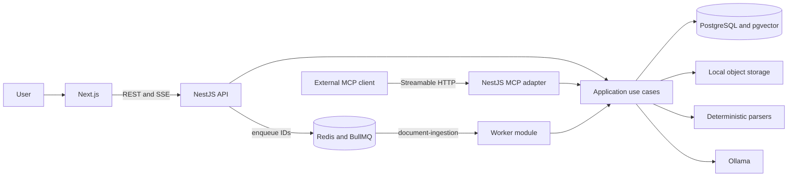
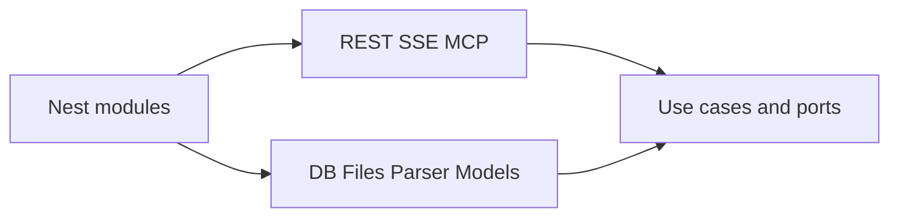
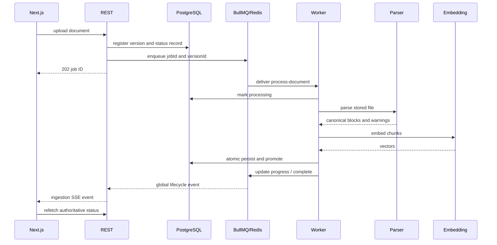
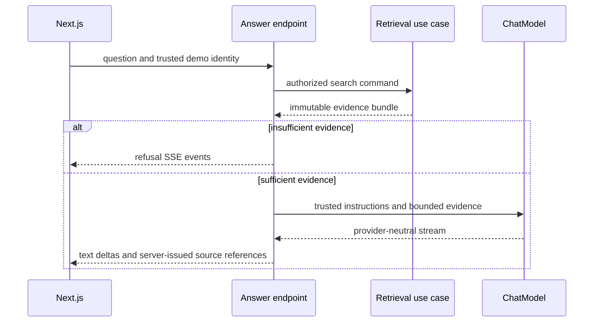

# Prototype architecture

This describes the existing local prototype. The proposed production architecture, quality gates, permission freshness and reliable queue handoff are defined in the [interview solution design](../submission/solution-design.md). Server-issued citations establish source traceability; this prototype does not validate every generated claim against its evidence.

## Container view

## Dependency rule

Application code owns policy and interfaces. Presentation maps transports to commands. Infrastructure implements ports. Composition is the only place concrete adapters are selected.

## Ingestion sequence

## Grounded answer sequence

## Trust boundaries
- Browser input, uploaded files, model output and retrieved document text are untrusted.
- Identity and authorization scope are derived by the host, never accepted from model tool arguments.
- Evidence IDs are issued by retrieval and resolved server-side.
- MCP transport types and provider SDK types stop at adapters.
- BullMQ payloads contain immutable identifiers only; workers load document metadata and content locations from PostgreSQL.
