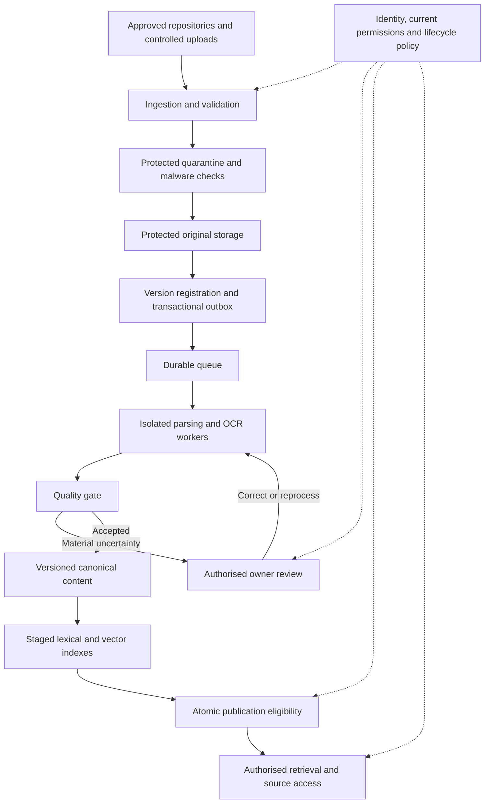
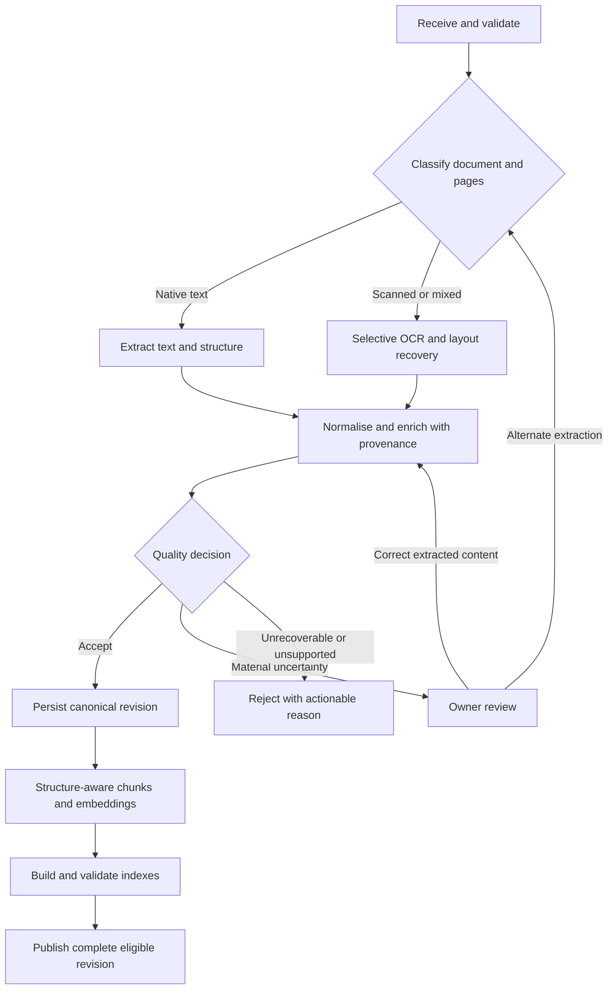

# Document Parsing Capability

**Solution design | Department AI-powered knowledge base | 19 September 2026**

## 1. Executive summary and problem

Students, teachers and corporate staff need reliable access to departmental policies, processes, guidelines and notices. These documents vary in format, layout, quality, currency and access restrictions. Extracting flat text alone can lose a table's meaning, detach a condition from its heading or expose an obsolete policy as current guidance.

The proposed capability converts documents into a structured, versioned and traceable representation for downstream search and retrieval-augmented generation (RAG). An AI-ready document preserves meaning and source context, carries enforceable permissions and lifecycle metadata, and has passed a quality gate. Creating embeddings alone does not make a document AI-ready.

The recommended approach is asynchronous processing with native extraction where reliable, selective OCR and layout processing where necessary, and human review for material uncertainty. Originals are retained under controlled access. Canonical content is the durable output; chunks and search indexes are derived, rebuildable representations. Only accepted, authorised and effective content is eligible for retrieval.

The main engineering decisions are to:

- Preserve document structure and provenance rather than optimise only for text volume.
- Publish complete versions atomically and keep a previous approved version available when replacement processing fails, unless it has expired or been withdrawn.
- Enforce permissions outside the model and check their freshness at retrieval time.
- Use measured document quality to select extraction tools and route exceptions.
- Design recovery and operational ownership alongside the successful processing path.

Success means that users can find current information appropriate to their access, trace it to its source and avoid silently corrupted or incomplete content. Parsing accuracy, review effort, processing time and cost must be measured on the Department's documents before production acceptance.

This document describes the proposed solution, not an assertion that every capability is implemented. The existing local prototype provides limited supporting evidence for ingestion, basic canonical blocks, version promotion and permission-filtered retrieval. It is not the submission deliverable or proof of production readiness.

## 2. Scope, assumptions and constraints

### Scope

The design covers ingestion from approved repositories and controlled uploads; validation; parsing/OCR; structure recovery; normalisation; metadata; quality review; AI-ready output; and storage/indexing. It includes document lifecycle, security and operations. Downstream answering is described only to establish the output contract and its limitations.

Target inputs include born-digital PDFs, Word documents, scanned or mixed PDFs, embedded images, tables, multi-column pages and poorly formatted documents. Markdown and plain text provide simple inputs and test cases. Unsupported formats are rejected visibly. Additional formats such as spreadsheets, presentations or email require discovery before inclusion.

### Working assumptions

- Source repositories remain authoritative for document ownership and access. SharePoint/CMS connectors are examples, not confirmed Department platforms.
- Each source can provide a stable identifier, change information and an access policy, or a nominated owner must supply and maintain them.
- English is the initial evaluation language. Other languages and accessibility needs must be represented before those populations are onboarded.
- Human reviewers are nominated by content owners; the platform team owns processing and recovery.
- Hosting and model services must be approved for the document classification. No cloud provider, residency location or legal retention period is assumed.

### Delivery boundary

The first pilot uses a controlled repository or upload route and a bounded corpus spanning the difficult formats in scope. Identity, permission enforcement, security validation and quality gates are pilot prerequisites, not optional production additions. Broader connector coverage and throughput follow measured results.

The prototype currently supports local PDF/Markdown/text ingestion, a two-tier public/staff demonstration of access and local model integration. It does not establish enterprise authentication, source ACL synchronisation, OCR/table fidelity, effective dating or operational service levels.

### Discovery decisions

Confirm source systems and owners; document counts, page distributions and change rates; scan quality and languages; permission semantics; effective-date rules; retention and deletion obligations; approved processing locations; available review capacity; and service/recovery targets. These determine sizing and acceptance, rather than being guessed from the demo.

## 3. Functional and non-functional requirements

### Functional requirements and traceability

| ID  | Required behaviour                                         | Design response                                                              | Acceptance method                                   |
| --- | ---------------------------------------------------------- | ---------------------------------------------------------------------------- | --------------------------------------------------- |
| FR1 | Ingest supported content and detect duplicates             | Controlled intake; stable source identity and scoped checksums, sections 4-5 | Valid, invalid, duplicate and changed-source cases  |
| FR2 | Preserve text, structure and source context across formats | Format routing and canonical blocks, section 5                               | Reviewed reference annotations by format            |
| FR3 | Detect material extraction loss and route exceptions       | Quality gate and review workflow, section 7                                  | Deliberately damaged and low-quality documents      |
| FR4 | Produce traceable AI-ready content and derived indexes     | Canonical records, chunks and provenance, section 5                          | Resolve chunks and citations to original content    |
| FR5 | Maintain current/effective versions and withdrawals        | Publication and lifecycle rules, section 6                                   | Replacement, future-date, expiry and deletion cases |
| FR6 | Respect document permissions throughout consumption        | Trusted identity and fresh access decisions, section 6                       | Cross-role, revocation and source-access tests      |
| FR7 | Recover and expose processing status                       | Durable handoff, replay and operational visibility, section 8                | Crash, outage and duplicate-delivery tests          |

### Non-functional requirements

| ID   | Quality attribute                   | Proposed acceptance approach                                                                                            |
| ---- | ----------------------------------- | ----------------------------------------------------------------------------------------------------------------------- |
| NFR1 | Extraction quality                  | Agree minimum scores per format and critical field; no known material loss may pass silently                            |
| NFR2 | Security and privacy                | No unauthorised content or metadata returned in the defined adversarial suite; assess residual risk before release      |
| NFR3 | Reliability                         | Demonstrate recovery without lost accepted work or partial publication; agree recovery point/time objectives            |
| NFR4 | Performance and scale               | Agree ingestion p95 by page/format class, freshness lag and retrieval p95; load-test forecast peak plus agreed headroom |
| NFR5 | Operability and cost                | Trace every job; measure cost per page/document and review effort; establish alerts and budget thresholds               |
| NFR6 | Maintainability and reproducibility | Version processing configuration, preserve lineage and run corpus regression checks before changes                      |

Numeric production commitments require the discovery workload and pilot measurements. Capture corpus size, daily changes, largest files, OCR share and peak concurrent consumers in a sizing worksheet. Measure native parsing, OCR, embedding and review separately: one latency figure would hide their different costs. Targets become release gates signed off by product, security and operations owners; they are not implied by prototype timings.

## 4. Proposed architecture

*Figure 1. Proposed architecture. Solid arrows show processing dependencies; dotted arrows show policy enforcement. Audit and monitoring span the flow.*

Approved connectors and the upload gateway establish source identity and validate the caller. Incoming bytes enter protected quarantine storage and are never directly searchable. Validation and malware checks precede promotion to protected original storage. Storage keys are generated by the service; submitted paths are not trusted.

The ingestion service records a version, processing status and an outbox event in one database transaction after confirming durable storage. An outbox dispatcher delivers identifier-only messages to a durable queue. Retries can deliver messages more than once, so workers claim a version/pipeline run and make repeated execution safe. Unregistered stored objects are reconciled and removed under a cleanup policy.

Workers retrieve originals through controlled access, execute the pipeline and stage canonical results. A quality service routes material uncertainty to a restricted reviewer workspace. Accepted output is indexed before an atomic publication decision makes the complete revision eligible. Consumers resolve eligibility through authoritative metadata, preventing staging or partial indexes from becoming visible.

The authoritative metadata store owns document identity, access-policy references, lifecycle and publication status. Protected object storage owns original bytes and larger extraction artifacts. Canonical blocks retain meaning and provenance; lexical/vector indexes support downstream discovery. A relational store with vector search is a reasonable initial choice, subject to measured performance.

Enterprise identity, authorisation, audit and monitoring apply across components. The review interface and source-download path use the same access boundary as search. Parser workers are isolated because both files and extracted content are untrusted. External extraction or embedding services sit outside that boundary and require explicit data-handling approval.

## 5. Processing and AI-ready information design

*Figure 2. Quality decisions precede searchable publication. Corrections retain source lineage and rerun validation.*

| Input                  | Initial approach                                                                               | Failure or loss checks                                      |
| ---------------------- | ---------------------------------------------------------------------------------------------- | ----------------------------------------------------------- |
| Digital PDF            | Native text plus page coordinates and layout recovery                                          | Missing text, overlapping order, columns, font encoding     |
| Word                   | Extract document structure, styles, lists and tables                                           | Inconsistent styles, merged cells, notes and linked content |
| Scanned/mixed PDF      | Detect image-only pages; OCR only where needed                                                 | Rotation, blur, low contrast, text/OCR duplication          |
| Tables and columns     | Preserve cells, headers, spans and reading regions                                             | Detached units, merged cells, row/column association loss   |
| Images/poor formatting | Preserve source region and caption; OCR text; specialist route or review for essential visuals | Meaningful diagram content lost or order unresolved         |

Normalisation repairs encoding and whitespace and identifies repeated headers/footers conservatively. It retains raw extraction and original references so removal can be audited. Metadata includes owner, audience, language, classification and lifecycle information; inferred values remain labelled suggestions until validated. Never infer access permissions from model output.

A logical document has immutable source versions. Each processing revision records parser/OCR versions, normalisation and chunking configuration, warnings and quality decisions. Blocks contain type, order, hierarchy, text or structured cells, and page/region references where available. Word provenance uses section and element identity; page numbers require a retained stable rendering.

**Illustrative output:** “Device policy”, version 2, section “Eligibility”, contains a paragraph linked to its heading and a table with columns “Audience” and “Conditions”. A table row retains both cell values and headers. Each block resolves to the original version and page/element, with warnings and the applicable access-policy reference. A chunk carries those block IDs and section context, not just the flattened row text.

Chunk on section and semantic boundaries, retaining heading paths and table headers. Start the pilot with a 500-token target and 800-token ceiling for prose, with up to 80 tokens of overlap only where a paragraph must split. These are tuning assumptions, not quality guarantees. Split large tables by rows with repeated headers; preserve access to the complete table. Record embedding model, dimensions and distance metric and rebuild a separate index on profile changes.

Downstream hybrid retrieval filters permissions and lifecycle before evidence is returned. Source citations resolve server-side to immutable provenance. A valid citation establishes traceability, not that every generated claim is supported; downstream answers require evidence-support evaluation and refusal when authorised evidence is inadequate.

## 6. Lifecycle, security and governance

### Versions and permissions

Use source-system identity plus source document ID as the logical identity. Uploads require an explicit new-document or replacement choice. A checksum detects unchanged content within the authorised document/source scope; it must not expose another user's matching file or merge unrelated policies.

Processing states are received, processing, review-required, accepted or failed. Publication eligibility is separate: a processed version may be future-effective, current, superseded, expired or withdrawn. A job retry does not change policy currency. Promote a complete, approved version atomically, using source revision ordering or owner confirmation to prevent a late older job replacing newer content.

Effective dates come from authoritative metadata or owner review. Default retrieval uses the approved version effective at query time. If a replacement fails, retain the previous version only while it remains valid. Withdrawal or expiry overrides that fallback. Historical access is explicit and separately authorised. Reprocessing retains the source version and creates a new processing revision; switch only after quality and index checks.

Authenticate people and service identities through the enterprise identity provider. Derive authorisation context server-side and preserve source policy semantics, including deny rules. Apply current policy to search, snippets, review, source fetches and citations; users and model tools cannot supply a broader scope.

Synchronise access changes independently of content extraction. Cache policy decisions only within an agreed freshness bound; sources with unknown or stale permissions become unavailable until validated. Revocation invalidates caches and blocks access without waiting for re-embedding. Already disclosed content cannot be recalled, so prevent stale results from entering new answers.

### Protection and governance

- Validate file signatures, limits and archive expansion; scan files and isolate parsers with resource/time limits and restricted network access.
- Encrypt transport and storage, manage keys centrally and use least-privilege service access.
- Preserve source classification. Suspected sensitive content triggers restricted review; automated detection is fallible and does not authorise release or silent redaction.
- Approve external processing based on classification, location, retention, training use and contractual controls. Local hosting alone does not establish compliance.
- Treat document text as untrusted. Separate instructions from evidence, restrict downstream tools and test prompt injection; residual manipulation risk remains.
- Audit uploads, review decisions, publication, policy changes, access denials and administrative replay. Protect question/answer audit data; avoid document bodies in operational logs.

Withdrawal immediately removes eligibility. Delete originals, canonical derivatives, embeddings and caches according to approved retention/legal-hold rules. Track deletion completion and reapply withdrawal/deletion records after restores; backup expiry follows the agreed retention policy rather than promising immediate physical erasure.

## 7. Quality, testing and acceptance

### Quality gate and review

Automated checks compare page coverage, text density, character anomalies, block order, heading hierarchy and table dimensions against source/extraction signals. Detect unexpected empty pages, missing regions and major changes from an earlier version. OCR confidence is only one signal; native extraction can be confidently wrong. Calibrate signals against human labels per document class.

Accept content when required structure/provenance is present and no material failure is detected. Minor cosmetic warnings may remain visible. Hold material uncertainty, including missing policy conditions or broken tables, for review. Reject unsupported, malicious or irrecoverably unreadable inputs with an actionable reason. Neither rejected nor review-required content is searchable.

Reviewers compare the original region with extracted output, correct or request reprocessing, and record the decision. Corrections create a traceable revision and rerun validation; they do not silently overwrite originals. Queue review by impact and age, assign an owner and allow escalation when review capacity is exceeded.

### Representative corpus and measures

Start with a proposed 60-document pilot corpus balanced across digital PDFs, Word, scans, mixed layouts, tables and poor formatting, including long documents, images, restricted content and conflicting versions. Overlap categories and report counts rather than implying equal representation. Document owners annotate critical facts, reading order, table relationships and source references. Hold back 20 documents for acceptance, then expand based on observed gaps.

| Measure                     | Method and acceptance decision                                                                                     |
| --------------------------- | ------------------------------------------------------------------------------------------------------------------ |
| Text and structure fidelity | Compare annotated text, order, headings and table-cell relationships; set per-class thresholds from pilot evidence |
| Material information loss   | No known critical omission may be silently published in the acceptance set; review all flagged critical regions    |
| Provenance                  | Every sampled chunk/source reference resolves to the correct immutable version and region                          |
| Review effectiveness        | Measure missed defects, unnecessary review, turnaround and correction effort                                       |
| Retrieval and answers       | Label relevant evidence for Recall@k; separately review citation support, unsupported claims and refusal           |
| Permissions and lifecycle   | No leakage in the defined cross-role, revocation, supersession, expiry and withdrawal cases                        |

Run regression comparisons before parser, OCR, chunking or embedding changes. Include crash/outage tests from section 8 and workload-based performance tests. A finite passing suite is evidence, not a guarantee of universal accuracy. Content owners approve quality; security approves access/data handling; operations approves recovery and service readiness.

### Existing evidence boundary

The repository has simple policy text fixtures and a three-question retrieval script that checks expected text or empty results. It does not measure Recall@k, table accuracy or unsupported-claim rate. Earlier demo observations are recorded separately and were not rerun for this document revision. Enterprise and difficult-document acceptance remains planned work.

## 8. Reliability, scalability and operations

| Failure                                     | Designed response                                                                                         |
| ------------------------------------------- | --------------------------------------------------------------------------------------------------------- |
| Database commit succeeds; queue unavailable | Transactional outbox retains accepted work; dispatcher retries; alert on oldest undispatched item         |
| Worker crashes or delivery repeats          | Lease/claim the processing revision, stage output idempotently and retry; one atomic publication decision |
| OCR/embedding dependency unavailable        | Timeout, bounded exponential backoff with jitter and reduced dispatch; resume without losing originals    |
| Invalid or repeatedly failing document      | Do not repeat deterministic failures blindly; fail or route to review; operator replay after remediation  |
| Replacement/index build fails               | Keep previous eligible revision; never expose partial output; explicit withdrawal still takes precedence  |
| Source access/policy becomes stale          | Fail closed for affected content; surface degraded status and reconcile before restoring access           |

A queue provides at-least-once delivery, not exactly-once processing. Record stages and attempt history in authoritative metadata. Proposed retry defaults are three transient attempts followed by a failed-work queue; operators inspect the cause and replay the same logical run or create a revised run when configuration changes. Expose status from metadata so missed progress notifications do not lose state.

Separate native parsing, OCR and embedding capacity because they have different CPU/GPU, memory and external quota demands. Scale workers using queue age and measured service time, with bounded concurrency, per-source quotas and backpressure. Apply page/file/time budgets to prevent one large document monopolising capacity. Batch embeddings where quality and provider limits permit.

Estimate capacity from changed pages per day, peak arrivals, measured pages per worker-minute and target freshness. Track storage growth from originals and retained revisions; calculate OCR, embedding and review costs separately. Reuse unchanged content within its authorised identity and reprocess only affected stages when compatible. Establish budget alerts before expanding source coverage.

Monitor throughput, p50/p95 stage latency, oldest pending/review item, retries, failures by format, quality drift, source-sync lag, stale policies, storage and cost per accepted document. Use correlation IDs without logging restricted payloads. The platform team owns availability and failed jobs; connector owners resolve source/policy failures; content owners own review and document correctness.

Agree recovery point/time objectives during discovery. Back up authoritative metadata and originals, test restoration and reconcile publication/policy state before serving traffic. Rebuild derived indexes from canonical content. Exercise queue loss, source outage and full restore during pilot acceptance; record actual recovery times rather than assuming backups imply recoverability.

## 9. Technical decisions and trade-offs

| Decision                 | Recommendation and reason                                                                                                  | Limitation / alternative                                                                                                         |
| ------------------------ | -------------------------------------------------------------------------------------------------------------------------- | -------------------------------------------------------------------------------------------------------------------------------- |
| Extraction               | Native parsing first; selective OCR/layout processing preserves structure without paying OCR cost everywhere               | Specialist services may outperform local libraries on difficult layouts; compare on the same labelled corpus                     |
| AI assistance            | Deterministic extraction as baseline; consider bounded AI repair for demonstrated gaps with retained provenance and review | Generative repair can invent content; an LLM-only pipeline is not the default                                                    |
| Canonical representation | Store typed blocks and relationships independently of chunks                                                               | More modelling than flat text, but supports re-chunking, audit and different consumers                                           |
| Storage/search           | Protected object storage plus relational metadata/canonical records and lexical/vector search initially                    | Dedicated search may improve scale/features but adds synchronisation and operational complexity                                  |
| Processing               | Durable asynchronous queue, transactional outbox and idempotent workers                                                    | Additional coordination, justified by long-running work and recovery; synchronous upload parsing is unsuitable for OCR workloads |
| Service sourcing         | Choose approved managed or self-hosted extraction from measured fidelity, privacy, cost and operational capability         | Managed services reduce upkeep; self-hosting improves deployment control but requires specialist operations                      |
| Human review             | Route material uncertainty to nominated owners                                                                             | Costs time and needs staffing; automatic publication alone is unsafe when quality cannot be established                          |

The prototype's PostgreSQL/vector search, Redis-backed queue and local model are reasonable tools for demonstrating boundaries, not a mandatory Department stack. Benchmark retrieval under realistic permission filters before adding approximate vector indexes or specialised infrastructure. Introduce a more complex component only when quality, latency or operational evidence justifies it.

Changing an embedding model changes the retrieval space. Build and evaluate a separate profile/index, then switch consumers atomically with rollback available; do not mix vectors from incompatible profiles. Parser and chunker changes require corpus regression tests even when the external format remains unchanged.

Downstream RAG can use lexical and semantic retrieval over the same authorised output. It should prefer current evidence, surface conflicting evidence and refuse unsupported answers. A read-only MCP adapter is one optional integration for AI clients; it is not required for parsing. Browser streaming and model-provider protocols are implementation concerns outside this solution's core scope.

## 10. Risks, delivery and open questions

| Risk                                       | Mitigation and remaining limitation                                                                           |
| ------------------------------------------ | ------------------------------------------------------------------------------------------------------------- |
| Complex layouts silently change meaning    | Representative annotations, specialist routing and review; unseen layouts still require monitoring            |
| Stale permissions or policy versions       | Independent policy sync, freshness checks and withdrawal precedence; source-system delays remain a dependency |
| Excessive review backlog                   | Measure review rate and capacity, prioritise high-impact documents and pause onboarding when necessary        |
| Vendor quality/cost changes                | Version configuration, regression-test replacements and retain portable originals/canonical output            |
| Prompt injection or unsupported answers    | Restrict downstream tools and evaluate evidence support; parsing controls cannot guarantee model correctness  |
| Sensitive data disclosed during processing | Approved services, least privilege and audit; deployment and contractual controls require Department approval |

### Delivery gates

1. **Discovery and corpus assessment:** confirm owners, sources, permission semantics, workload and data-handling constraints; annotate the pilot corpus and agree provisional acceptance targets.
2. **Controlled pilot:** implement the complete path for a bounded source set, including difficult formats, review, identity and lifecycle controls. Exit only when held-out quality, adversarial access, failure recovery and measured cost are accepted.
3. **Production readiness:** approve service targets and review staffing; exercise backup/restore, deletion and incident response; complete security and user-accessibility review against Department requirements. Prepare support runbooks and rollback.
4. **Measured expansion:** onboard sources incrementally, monitor quality/cost/freshness and expand capacity or extraction tooling only from observed need.

### Decisions requiring Department input

Which repositories and identity policies apply? Who is accountable for content currency and review? Which languages and accessibility requirements must the first release support? What scan quality and change volume are typical? What are acceptable ingestion delay, permission freshness and outage recovery? Which processing locations and suppliers are approved? What retention, legal-hold and historical-access rules apply?

### AI-use declaration

- **Tools used:** Cursor AI for the existing prototype and initial documentation, as recorded in the repository; ChatGPT/Codex for design review, restructuring and submission preparation.
- **How used:** to identify gaps against the exercise, draft explanations and diagrams, distinguish prototype evidence from proposed capabilities, and prepare this Markdown submission.
- **Review and validation:** this revision was checked against the supplied brief, repository documentation and selected implementation evidence; the Markdown was checked for structure, self-contained explanations and consistent references. Production acceptance tests described here are proposed, not completed results. The candidate remains responsible for reviewing and owning the architectural decisions and confirming this declaration before submission.
