# Document Parsing Capability

Solution design | Department AI-powered knowledge base | 19 September 2026

> **Review scope:** This is the authoritative proposal. It describes a production
> capability, not completed implementation. The design deliberately avoids naming
> a cloud or product until Department data, identity, residency and support
> constraints are confirmed.

## 1. Recommendation

Departmental policies, processes, guidelines and notices vary in format, layout,
quality, currency and access restrictions. Flat text extraction can silently
detach a condition from its heading, destroy table relationships, or make an
obsolete policy appear current.

I recommend an asynchronous parsing capability that:

- preserves document structure and source provenance in an immutable canonical
  representation;
- uses native extraction first, selective OCR or specialist layout processing
  where measured quality requires it, and owner review for material uncertainty;
- stores originals and canonical content as durable records while treating chunks,
  embeddings and search indexes as rebuildable derivatives;
- publishes only complete, accepted, authorised and effective revisions; and
- enforces current permissions outside AI models and fails closed when policy
  freshness is unknown.

An **AI-ready document** is therefore not merely embedded text. It is structured,
versioned, traceable content with lifecycle and policy references that has passed
an explicit quality decision.

## 2. Scope, assumptions and requirements

### Scope

The capability covers approved repository connectors and controlled uploads,
validation and malware scanning, native parsing, OCR and layout recovery,
normalisation, metadata, quality review, canonical storage, chunking, indexing,
publication and operational recovery. Retrieval is included only to define the
security boundary of the output; answer generation is downstream.

Initial formats are born-digital PDF, Word, scanned or mixed PDF, embedded images,
tables, multi-column pages, Markdown and plain text. Spreadsheets, presentations,
email, multilingual content and essential visual interpretation require discovery
and representative evaluation before inclusion.

### Working assumptions and discovery

- Source repositories remain authoritative for document identity, ownership,
  currency and access policy.
- A source supplies a stable document ID, ordered change information and an ACL
  reference. Controlled uploads require an owner to supply those fields.
- English is the initial evaluation language. Language and accessibility needs
  must be represented before affected user groups are onboarded.
- Content owners provide authorised reviewers; the platform team owns processing,
  recovery and operational tooling.
- Processing location, suppliers, retention, legal hold, service targets and
  review capacity require Department approval.

Discovery must establish source systems, document/page counts, change and peak
arrival rates, scan quality, languages, permission semantics, effective-date
rules, classifications, retention and deletion obligations, and available review
capacity. These facts set production thresholds and sizing.

### Traceable requirements

<!-- markdownlint-disable MD013 -->

| ID | Required behaviour | Acceptance evidence |
| --- | --- | --- |
| FR1 | Ingest supported content and detect unchanged or duplicate versions without leaking cross-owner information | Valid, invalid, changed and scoped-duplicate cases |
| FR2 | Preserve text, reading order, headings, lists, tables, accessibility metadata and source regions | Owner-reviewed annotations by format |
| FR3 | Detect material extraction loss and route uncertain, unsafe or unsupported content visibly | Damaged scans, complex layouts and adversarial files |
| FR4 | Produce canonical blocks, derived chunks and citations that resolve to an immutable source version | Sample every output type back to its source |
| FR5 | Enforce effective dates, supersession, expiry, withdrawal and deletion | Lifecycle transition and replacement-failure cases |
| FR6 | Apply current source permissions to review, search, snippets, citations and original download | Cross-role, revocation and stale-policy tests |
| FR7 | Recover accepted work without loss or partial publication | Crash, outage, retry, restore and duplicate-delivery tests |

<!-- markdownlint-enable MD013 -->

Quality, security, reliability, performance, cost and operability targets become
release gates after discovery. Refusing invented production SLAs is intentional;
Section 7 provides a hypothetical sizing example to show the method.

## 3. Proposed architecture



*Figure 1. Content flows from sources through intake, processing and publication.
Dotted lines are external or operational
control paths. Canonical content is durable; indexes are staged derivatives.
[Mermaid source](assets/architecture.mmd).*

### Intake and connector responsibilities

Each connector performs an initial backfill and then consumes an ordered change
cursor or webhook. A reconciliation poll detects missed notifications. It maps
source identity, version, owner, classification, lifecycle metadata and an ACL
reference without attempting to simplify source deny rules. Per-source quotas and
circuit breakers prevent one failing repository from blocking others.

Controlled uploads use an authenticated gateway and require an explicit
new-document or replacement choice. Checksums are compared only within the same
authorised source/document scope: they avoid repeated work but never reveal that
another user uploaded matching content.

Incoming bytes enter protected quarantine and are never searchable. File
signatures, size and archive expansion limits, malware checks and generated
storage keys are applied before promotion to protected original storage.

### Durable handoff and publication

After durable object storage is confirmed, the ingestion service commits the
version, processing status and outbox event in one metadata transaction. The
dispatcher sends identifier-only messages to a durable queue. At-least-once
delivery is expected, so workers lease a pipeline run and stage results
idempotently.

Sandboxed workers have resource/time limits and restricted network access.
External OCR, layout or embedding services are used only when approved for the
document classification, processing location, retention and training terms.

The metadata store is authoritative for identity, attempts, policy references,
lifecycle and publication state. Originals and large artifacts live in protected
object storage. Canonical blocks are the durable AI-ready output. Lexical/vector
indexes are rebuilt from accepted canonical revisions and become visible only
after an atomic eligibility switch.

## 4. Per-document processing and information model



*Figure 2. Material uncertainty is reviewed; unsupported, unsafe or unreadable
inputs are rejected visibly. [Mermaid source](assets/processing-quality.mmd).*

Native PDF and Word extraction retains hierarchy, page or element identity,
coordinates where stable, lists and table structure. Image-only or unreliable
pages use selective OCR to avoid both unnecessary cost and duplicate text.
Complex tables, diagrams or layouts can use an approved specialist route. All
routes preserve raw extraction and warnings so normalisation remains auditable.
Authored alternative text is retained; missing descriptions for essential visuals
and broken heading/table semantics are flagged for accessibility review.

The target canonical shape is illustrated below; it is a logical contract rather
than a technology-specific schema:

```yaml
documentId: source-a/policy-123
sourceVersion: "42"
processingRevision: parser-3.1_ocr-2_chunk-4
owner: policy-team
classification: staff
effectiveFrom: 2026-10-01
policyReference: acl/source-a/policy-123
blocks:
  - id: b17
    type: table
    headingPath: [Eligibility]
    sourceRegion: { page: 4, x: 72, y: 188, width: 450, height: 210 }
    table:
      columns: [Audience, Conditions]
      cells:
        - row: 1
          column: 1
          text: Teachers
          rowSpan: 1
          columnSpan: 1
        - row: 1
          column: 2
          text: Manager approval
          rowSpan: 1
          columnSpan: 1
    warnings: []
qualityDecision: accepted
```

Each processing revision records parser/OCR versions, normalisation and chunking
configuration, quality signals and reviewer decisions. Word provenance uses
section/element identity; page numbers are claimed only when a stable rendering
is retained.

Chunks follow section and semantic boundaries and retain heading paths, block IDs
and table headers. A pilot starts with a 500-token target, 800-token ceiling and
up to 80 tokens of overlap only when a paragraph must split. These conservative
defaults leave room for neighbouring evidence in downstream context; they are
tuned against retrieval recall, answer support and document length distribution.
An embedding profile records model, dimensions and distance metric. Profile
changes build a separate index and switch atomically after evaluation.

## 5. Quality and acceptance

Automated checks compare page coverage, text density, character anomalies,
reading order, heading hierarchy, table dimensions, source regions and changes
from the prior version. OCR confidence is only one signal: native extraction can
also be confidently wrong.

The quality decision is:

- **accept** when required structure and provenance exist and no material loss is
  detected;
- **review** when uncertainty could alter meaning, such as a missing policy
  condition, unresolved reading order or broken table relationship; or
- **reject** when the input is unsafe, unsupported or irrecoverably unreadable.

For example, a table-heavy policy PDF with all pages present but a merged
“Conditions” cell detached from two audiences is not accepted because text
completeness hides semantic loss. It is sent to an owner with the source region
and extracted table side by side. A corrected extraction re-enters normalisation
and all checks; an unsuitable extraction route returns to routing. The decision,
actor and correction are audited.

Start with approximately 60 documents so each major initial class can contribute
about ten examples, while allowing categories to overlap. Owners annotate text,
critical facts, reading order, headings, table relationships and source regions.
Reserve roughly 20 documents as a held-out acceptance set. These counts are a
practical starting point, not statistical proof; expand classes where observed
variation or error warrants it.

Acceptance measures include:

- text, order, hierarchy and table-cell fidelity by document class;
- zero known critical omission silently published in the held-out set;
- provenance resolution from every sampled chunk to the correct source region;
- review false-negative rate, unnecessary review, turnaround and correction cost;
- retrieval Recall@k and citation support measured separately from parsing; and
- no content or metadata leakage in defined permission and lifecycle tests.

Parser, OCR, normalisation, chunking and embedding changes run corpus regression
before release. Content owners approve fidelity, security approves access/data
handling, and operations approves recovery and service readiness.

## 6. Lifecycle, security and governance



*Figure 3. Processing success does not itself make content current. Withdrawal
and expiry override fallback. [Mermaid source](assets/lifecycle.mmd).*

A source version is immutable; reprocessing creates a processing revision.
Publication eligibility is evaluated separately from processing. A complete,
approved revision becomes current only when effective. Late older jobs cannot
replace newer source revisions. If replacement processing fails, the previous
approved revision remains available only while still effective and not withdrawn.

ACL changes synchronise independently of parsing and embedding. The retrieval
boundary combines enterprise identity with current source-policy semantics,
including deny rules. Decisions may be cached only within an agreed freshness
bound. Revocation invalidates caches; unknown or stale policy makes affected
content unavailable until reconciled.

Additional controls are:

- encryption in transit and at rest, central key management and least-privilege
  service identities;
- untrusted-file isolation, dependency scanning and no document bodies in queue
  messages or operational logs;
- restricted reviewer workspaces using the same policy boundary as retrieval and
  original download;
- prompt-injection testing and read-only, bounded downstream tools—parsed text is
  evidence, never trusted instruction;
- audit of uploads, review, publication, policy changes, denied access, replay
  and deletion; and
- deletion of originals, canonical derivatives, indexes and caches under approved
  retention/legal-hold rules, including reapplication after restore.

## 7. Reliability, scale and operations

Key failure behaviour is designed before scaling:

<!-- markdownlint-disable MD013 -->

| Failure | Response |
| --- | --- |
| Metadata commits while queue is unavailable | Outbox retains work; dispatcher retries and alerts on oldest item |
| Worker crashes or receives a duplicate | Lease the processing revision, write staged output idempotently and retry |
| OCR or embedding service is unavailable | Timeout, bounded exponential backoff with jitter, reduce dispatch and preserve originals |
| A deterministic input fails repeatedly | Stop blind retries; reject or review, then allow controlled operator replay |
| Replacement or index build fails | Keep the previous eligible revision; never expose partial output |
| Source ACL is stale | Fail closed for affected content and reconcile before restoring access |

<!-- markdownlint-enable MD013 -->

Three transient attempts are an initial default: one immediate retry handles a
brief fault, delayed retries cover a short dependency interruption, and then the
system stops consuming capacity without diagnosis. Deterministic errors bypass
retries. Configuration changes create a new logical run rather than rewriting
history.

### Hypothetical sizing example

Assume, only to demonstrate the method, 50,000 changed pages/day, 15% requiring
OCR, a four-hour freshness objective, measured native throughput of 30 pages per
worker-minute and OCR throughput of two pages per worker-minute. The four-hour
burst requires about six native and sixteen OCR workers at full utilisation;
starting capacity might be eight and twenty respectively to provide headroom.
Real measurements must replace every number before commitment.

Native parsing, OCR and embedding pools scale separately from queue age and
measured service time, with bounded concurrency, per-source quotas, page/file
budgets and backpressure. Cost is tracked separately for OCR, embeddings, storage
and human review.

Monitor throughput, p50/p95 stage latency, oldest outbox/queue/review item,
failures and retries by format, quality drift, ACL-sync age, storage growth and
cost per accepted page/document. Alert examples include an outbox item older than
the handoff objective, review age approaching its SLA, stale source policy, a
format-specific failure spike and an unexpected quality-score shift.

The platform team owns processing and recovery; connector owners resolve source
and ACL failures; content owners own review and currency. Back up metadata and
originals, test restoration, reconcile lifecycle/policy before serving, and
rebuild derived indexes from canonical content. Recovery point and time objectives
are agreed during discovery and verified by queue-loss and full-restore exercises.

## 8. Decisions and trade-offs

<!-- markdownlint-disable MD013 -->

| Decision | Recommendation | Trade-off or alternative |
| --- | --- | --- |
| Extraction | Native first; selective OCR/specialist routes selected by measured fidelity | One universal parser is simpler but silently loses difficult structure |
| AI assistance | Deterministic extraction baseline; bounded AI repair only for demonstrated gaps with provenance and review | Generative repair can invent content |
| Canonical model | Typed blocks and relationships independent of chunks | More modelling than flat text, but supports audit and re-chunking |
| Storage/search | Protected object storage plus relational metadata/canonical records and lexical/vector search initially | Dedicated search may help scale but adds synchronisation and operations |
| Processing | Durable asynchronous queue, transactional outbox and idempotent workers | More coordination than synchronous upload, justified by long OCR jobs and recovery |
| Human review | Route material uncertainty to nominated content owners | Costs time and requires staffed escalation |
| Managed vs self-hosted | Decide from the same labelled corpus, classification, residency, cost and support evidence | Managed reduces upkeep; self-hosting increases operational responsibility |

<!-- markdownlint-enable MD013 -->

Introduce approximate vector indexes, reranking or a specialised search service
only when realistic permission-filtered benchmarks justify the complexity.

## 9. Delivery, risks and open decisions

1. **Discovery and corpus:** confirm sources, owners, permissions, workload and
   data handling; annotate the corpus and agree provisional gates.
2. **Controlled pilot:** deliver one bounded source path with enterprise identity,
   ACL sync, quarantine, outbox, native parsing plus difficult-document routes,
   review, lifecycle and failure recovery.
3. **Production readiness:** approve targets and reviewer staffing; exercise
   restore, deletion and incident response; complete security and accessibility
   review; prepare runbooks and rollback.
4. **Measured expansion:** onboard sources incrementally and expand tooling or
   capacity only from observed quality, freshness and cost.

Principal residual risks are unseen layouts that alter meaning, delayed source
permission changes, excessive review backlog, supplier quality/cost changes,
sensitive-data handling and malicious instructions in content. Mitigations reduce
but do not eliminate these risks; phased onboarding and monitored quality drift
limit exposure.

Department decisions still required are: source and identity systems; accountable
content owners; initial languages and accessibility standard; expected volume and
scan quality; latency, ACL freshness and recovery targets; approved processing
locations/suppliers; and retention, legal-hold and historical-access rules.

## AI-use declaration

I used Cursor AI while building the supporting prototype and initial
documentation, and ChatGPT/Codex to challenge assumptions, identify gaps against
the supplied exercise, restructure this proposal and draft diagram source. I
reviewed the brief and every final section myself, checked proposed capabilities
against the stated scope, reconciled terminology and lifecycle behaviour across
the diagrams and text, and verified that prototype observations were not presented
as production evidence. I own the final architectural decisions and trade-offs.
